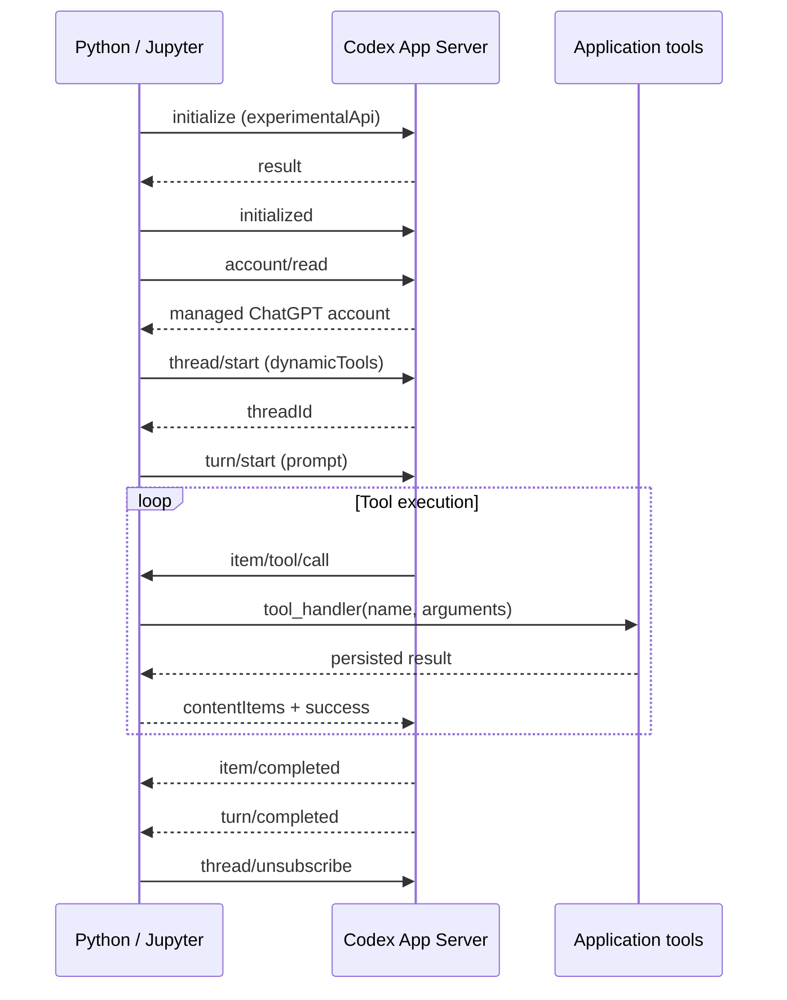
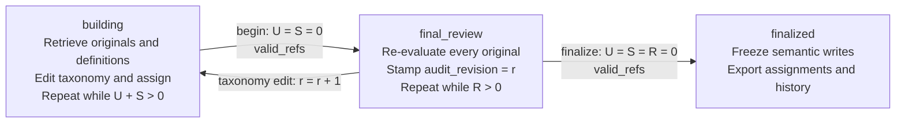

# Architecture

## 1. Local connection protocol

Python owns an App Server subprocess for the lifetime of `CodexConnection`. A reader thread routes JSON-RPC responses to waiting callers and notifications to the active turn. Turns are serialized. Each turn uses a fresh ephemeral thread; application memory survives independently.

Cancellation interrupts this connection's active turn. EOF and protocol errors wake pending requests. Cleanup terminates only the owned subprocess. The transport returns the final agent message; classification results are read from SQLite rather than reconstructed from that message.

## 2. External-memory classification state machine

Let `r` be the taxonomy revision, `U` the unassigned item count, `S` the stale assignment count, and `R` the items not audited at revision `r`. `valid_refs` means all assignments refer to active category definitions at their current versions.

Explicit `reopen` returns a finalized memory to building. The classifier prompt requests evidence-based category creation, revision, merge, and split. Category edits are atomic and require an expected revision. They retain prior definitions and mark affected assignments stale. Any taxonomy revision invalidates the old final audit globally through revision comparison, without updating every item row during the edit.

The controller handles empty-queue state transitions and stops after three turns without persisted progress. Only records actually retrieved during the current turn can be assigned through `TaxonomyAgent`. Database checks enforce complete coverage and version consistency; model judgment still determines whether the categories are useful.

## Public tool contract

| Tool | Operation |
| --- | --- |
| `memory_status` | Counts, taxonomy revision, phase, completion state |
| `next_items` | Paginated work, review, or complete item queue |
| `search_memory` | Literal or FTS5 search of originals or active category definitions |
| `read_categories` | Current definitions, evidence IDs, optional version history |
| `edit_categories` | Atomic create, revise, merge, or split with revision checks |
| `assign_items` | Assignment/review at an exact active category version |
| `review_control` | Begin review, finalize, or reopen |

Pages contain at most 200 records and normally fit a 60,000-character serialized budget. A single oversized record is returned whole and flagged; callers must prepare sensible record boundaries. Batch size guides model context and does not enforce a total input or category limit.

One agent owns one writer job. SQLite serializes transactions; revision checks reject conflicting taxonomy edits. This is not a distributed worker scheduler. Resume identity includes exact sorted unique text and prompt. Arbitrarily changing an existing dataset is intentionally rejected; start a new memory instead.
